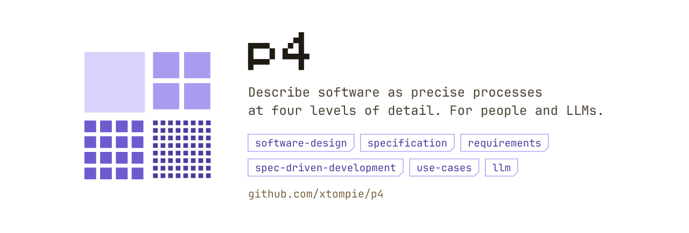
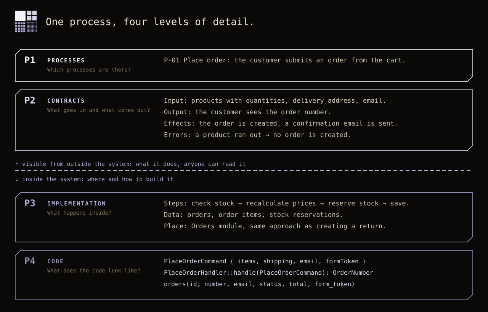

<picture>
  <source media="(prefers-color-scheme: dark)" srcset="assets/banner-dark.svg">
  
</picture>

**P4 Model** is a way to describe software as precise processes, at four levels of detail: from a list of processes anyone can read, down to code.

---

## In short

A **process** is a single interaction with the system: someone does something (or something happens at a given time), the system handles it, and the process ends. Example: *Registration* is submitting the sign-up form; it ends when the activation email is sent. Clicking the link in that email is a separate process: *Account activation*.

You describe any change to a system (a new feature, a fix, a whole new system) as a list of such processes. Then you describe the same processes in more and more detail. Each level answers one question:

| # | Level | Question | What belongs there |
|---|---|---|---|
| L1 | **Processes** | Which processes are there? | A name for each process, with a short note when the name alone is not clear. |
| L2 | **Contracts** | What goes in and what comes out? | Input, output, and the effects visible from outside, such as an email sent. For an API: request, response and the errors that are part of the contract. |
| L3 | **Implementation** | What happens inside? | What the system does that is not visible from outside: steps, data, where in the code. |
| L4 | **Code** | What does the code look like? | Code or pseudocode, as detailed as needed. |



The levels are also called **L1 to L4**: "up to L2" means levels 1 and 2. On every level a process is marked with both the level and its ID: **L3P01** is process P01 on level 3. Every heading then says where you are, without scrolling to the section.

The line between levels 2 and 3 is simple: **can you see it from outside the system?** If yes, it belongs to level 2. If it happens inside, it belongs to level 3.

Write only what carries information. The short forms below are the default. Each level also has an extended template: a checklist for large, risky or cross-team processes, not a set of required fields.

---

## Details

### Process

A process is a single interaction with the system, from start to end.

- It has **one start**: someone does something (submits a form, clicks a button, calls an API) or something happens (a scheduled time, a message from another system).
- It has **one end**: the system is in a new state, or it has given something back (a response, an email, a file).
- It is **as small as possible**. The smaller the process, the easier it is to understand, discuss and build.

What people usually call a process, such as "creating an account" or "fulfilling an order", is a **group of processes** in P4:

- Creating an account = *Registration* + *Account activation*
- Fulfilling an order = *Place order* + *Confirm order* + *Export orders*

**Is it one process?** Check three things:
1. **One trigger from outside.** A person, another system or the clock starts it. Something the system does to itself halfway through is not a new process.
2. **Complete input.** The input makes sense on its own. A multi-step form that only means something when finished is one process, not one per step.
3. **One uninterrupted reaction.** The system handles it from start to end without waiting for anyone. If the system has to wait for a person or another event, the part after the wait is a new process.

Signs that a new process starts:
- the description says "then the user…", "next, the admin…", "after clicking the link…";
- there is a gap in time and the system waits for someone or something;
- a different person or system starts it.

Each process gets an ID and a name, e.g. `P01 Place order`. The ID never changes between levels. On each level the process is written with the level in front: `L1P01`, `L2P01`, `L3P01`, `L4P01`.

### Rules

1. **One document that grows downward.** Level 1 lists the processes in scope. Level 2 repeats them and describes each one in more detail. Levels 3 and 4 do the same.
2. **A lower level never changes a higher one.** If something above needs to change, go back to that level, fix it, agree on the change, and come down again.
3. **Every level stands on its own.** Stop where the next level is no longer needed. Level 1 alone is a complete use of P4.
4. **Precision depends on the need.** A contract can say "products, address, email" or be an exact API description with fields and types. A simple process may have a two-line level 3.
5. **Levels can be added or skipped.** Four levels are the default. A large or distributed system may need an extra level (see [Extra levels](#extra-levels)).
6. **If you don't know how, you don't write code.** Level 3 points to an existing place in the system that the new code will follow. Open questions must be resolved before coding starts.

7. **The forms are examples, not a format.** What matters is that each level answers its question. The templates below show one way to write it; use any clear wording.

### Changing existing processes

Most work changes a system that already exists. Then the document covers only the processes the change touches, and on each level describes only what changes.

- Level 1 lists the affected processes and says in one line what changes in each.
- Levels 2 to 4 describe the change: what is different, and what must stay the same. Parts of a process that do not change are not repeated.
- A new process in the same change is described in full, like any other.

```markdown
## Level 1: Processes

- L1P01 Place order: also accepts a discount code.
- L1P02 Confirm order: no change in behaviour; the confirmation email shows the discount.
- L1P07 Apply discount code (new): the customer checks a code before ordering.
```

### Who uses which level

- **Levels 1–2** describe the system from the outside, without technology. Anyone who knows the product can read them: client, owner, analyst, tester. They settle **what** the system does.
- **Levels 3–4** describe the system from the inside. They settle **where and how** to build it.

Typical uses:
- **With the business:** write and agree on levels 1–2 together. The technical team then does levels 3–4.
- **Without the business** (your own product, the team decides): the team goes as deep as it needs.
- **Quick scoping:** level 1 only. A quarter of an hour, and you can see whether anything is missing.
- **API design:** level 2 with exact payloads and status codes is a ready API contract.
- **Working with a developer:** the developer delivers the document up to level 3 (or 4), and writes code only after it is accepted.

---

### Level 1: Processes

**Question:** which processes are there?

Name each process so it can be told apart from the other processes in the system. The name is often enough. When it is not, add one short note: who does what. "Account activation" may be clear on its own; "Reconciliation" is not.

Level 1 is not the contract. Inputs, outputs, emails, rules and errors belong to level 2, not to the note.

```markdown
## Level 1: Processes

- L1P01 Registration: a visitor submits the sign-up form.
- L1P02 Account activation
```

Check: every interaction with the system is a separate process, and each one passes the "is it one process?" check.

---

### Level 2: Contracts

**Question:** what goes in and what comes out?

The contract is what the system promises to the outside world:
- **Input:** the data that comes in.
- **Output:** what the system gives back.
- **Visible effects:** what changes for the outside world, such as an email sent, a file produced or a message to another system.
- **For an API:** the request payload, the response payload, and the errors that are part of the contract, for example 400 for invalid input or 404 when an item does not exist.

Describe input and output in words or exactly (fields, types, sample data). Choose the precision you need.

```markdown
## Level 2: Contracts

### L2P01 Registration
- Input: email, password, name
- Output: the visitor sees "Check your inbox"
- Effects: an inactive account is created; an activation email is sent
- Errors: invalid data → nothing is created, the form shows what is wrong
```

**Extended template (optional).** For a large or risky process, go through this checklist and write down the items that apply:
- Who: who or what starts the process.
- Start: what they do.
- Conditions: what must be true for the process to start (permissions, state).
- Input, Result, Output.
- State: state before → state after.
- Rules: limits, quotas, expiry times, what the system calculates.
- When something goes wrong: specific situations along the way (a product ran out, an email failed to send, a double click) and what happens in each.
- Always true: what holds even when something goes wrong.

Level 2 never mentions tables, class names or the internal order of steps.

---

### Level 3: Implementation

**Question:** what happens inside?

Describe what the system does that is not visible from outside, in as much detail as needed: the steps, the data, where in the code it goes, and the existing part of the system to follow. This is where the developer decides **where** something belongs before writing it.

```markdown
## Level 3: Implementation

### L3P01 Registration
- Steps: validate → create the inactive user → create the activation link → queue the email
- Place: Accounts module, same approach as inviting a user in the Team module
```

**Extended template (optional):**
- Steps: what the system does inside, in order.
- Data: what is stored and where.
- Safeguards: how each "when something goes wrong" and "always true" item from level 2 is handled.
- Place in code: module; what is new; what existing parts are reused.
- Pattern: the existing place in the system to follow.
- Extra steps: database changes, configuration, templates, scheduled jobs, permissions.
- Open questions: what is not known yet. Must be empty before coding.

---

### Level 4: Code

**Question:** what does the code look like?

Code or pseudocode, at whatever level of detail is needed: from signatures and tables to full implementation.

```markdown
## Level 4: Code

### L4P01 Registration
- `RegisterHandler::handle(RegisterCommand): void`
- `users(id, email unique, password_hash, name, status, created_at)`
```

**Extended template (optional):**
- Structures: input and output objects with fields and types.
- Classes and methods: signatures.
- Tables: columns and types.
- Tests: one per rule, per "when something goes wrong" situation and per "always true" item from level 2.

---

### Extra levels

Examples of levels you can add:

- **Map** (above Processes): groups of processes, e.g. "Creating an account = P01 Registration + P02 Account activation". Useful when there are many processes.
- **Services** (between Implementation and Code): which service or system handles which step, and how they talk to each other. Useful in distributed systems.

An added level follows the same rules: it repeats all processes and never changes the levels above it.

---

## Example: registration

The default, short form. What people call "creating an account" is four processes in P4. One of them is started by the clock, not by a person.

### Level 1: Processes

- L1P01 Registration: a visitor submits the sign-up form.
- L1P02 Account activation: the user clicks the activation link from the email.
- L1P03 Resend activation link: the user asks for a new activation link.
- L1P04 Remove unactivated accounts: every night the system removes accounts not activated within 7 days.

### Level 2: Contracts

#### L2P01 Registration
- Input: email, password (at least 10 characters), name, terms accepted
- Output: the visitor sees "Check your inbox"
- Effects: an inactive account is created; an activation email with a link valid for 24 hours is sent
- Errors: invalid data → nothing is created, the form shows each wrong field; email already registered → the same "Check your inbox", and that address gets a "someone tried to register" email

#### L2P02 Account activation
- Input: the code from the link
- Output: "Account activated", the user can log in
- Effects: the account becomes active; the link stops working
- Errors: expired link → a message with "Send a new link" (P03); unknown or replaced link → "This link is not valid"

#### L2P03 Resend activation link
- Input: email
- Output: "If an inactive account exists for this address, we have sent a new link"
- Effects: a new activation email; all previous links stop working
- Errors: more than 3 requests per hour for one address → "Too many attempts, try again later"

#### L2P04 Remove unactivated accounts
- Input: none (runs every night at 03:00)
- Effects: inactive accounts older than 7 days are removed; active accounts are never removed

### Level 3: Implementation

#### L3P01 Registration
- Steps: validate → normalise the email → if it exists, queue the "someone tried" email and stop → create the inactive user → create the activation link → queue the activation email
- Data: users (email unique), activation links (only a fingerprint and expiry are stored), outgoing emails
- Place: Accounts module, same approach as inviting a user in the Team module

#### L3P02 Account activation
- Steps: find the link by fingerprint → check it is unused and not expired → activate the account and mark the link as used, in one transaction
- Place: Accounts module, same approach as password reset

#### L3P03 Resend activation link
- Steps: find the inactive account → cancel its links → create a new link → queue the email; requests are counted per address per hour
- Place: Accounts module, reuses link creation from P01

#### L3P04 Remove unactivated accounts
- Steps: select inactive accounts older than 7 days in batches → remove each one with its links; a failure is logged and retried the next night
- Place: Accounts module, scheduled job like the nightly cleanup of expired sessions

### Level 4: Code

#### L4P01 Registration
- `RegisterCommand { email: string, password: string, name: string, termsAccepted: bool }`
- `RegisterHandler::handle(RegisterCommand): void`
- `activation_links(id, user_id, fingerprint, expires_at, used_at, cancelled_at)`

#### L4P02 Account activation
- `ActivateAccountHandler::handle(ActivateAccountCommand { code: string }): void`

#### L4P03 Resend activation link
- `ResendActivationLinkHandler::handle(ResendActivationLinkCommand { email: string }): void`

#### L4P04 Remove unactivated accounts
- `RemoveUnactivatedAccountsJob::run(now: datetime): int`

---

## Example: online shop (extended form)

The same idea with the extended templates. Use this form for large, risky or cross-team processes, where a missed case is expensive.

### Level 1: Processes

- L1P01 Place order: the customer submits an order from the cart.
- L1P02 Confirm order: the admin confirms a new order.
- L1P03 Export orders: the admin downloads orders from a chosen period as a CSV file.

### Level 2: Contracts

#### L2P01 Place order
- Who: customer
- Start: submits the order form
- Conditions: the cart is not empty
- Input: products with quantities, delivery address, email
- Result: the order is accepted, the customer sees the order number
- Output: order confirmation email
- State: none → **New**
- Rules:
  - the system calculates the price; the price sent by the form is ignored
  - stock is reserved until the order is confirmed or cancelled
- When something goes wrong:
  - a product ran out in the meantime → no order is created, the customer sees which product is missing
  - the email failed to send → the order stays, the email arrives later
  - double click → only one order is created
- Always true: no stock stays reserved without an order

The same contract in exact form, when designing an API:

```
POST /orders
{
  "items": [{ "sku": "A-100", "qty": 2 }],
  "shipping": { "street": "1 Long St", "city": "Springfield", "zip": "12345" },
  "email": "jane@example.com"
}

201 Created
{ "orderNumber": "ORD-2026-0001" }

409 Conflict
{ "error": "out_of_stock", "sku": "A-100" }
```

#### L2P02 Confirm order
- Who: admin
- Start: clicks "Confirm" on an order
- Conditions: admin is logged in, the order is in state "New"
- Input: order number
- Result: the order is confirmed
- Output: email to the customer "your order is being prepared"
- State: New → **Confirmed**
- Rules: only admins with the orders permission can confirm
- When something goes wrong:
  - the order is already confirmed or cancelled → nothing changes, the admin sees a message
  - the email failed to send → the order stays confirmed, the email arrives later
- Always true: an order is confirmed at most once

#### L2P03 Export orders
- Who: admin
- Start: clicks "Export" and picks a date range
- Conditions: admin is logged in
- Input: date from, date to
- Result: the admin downloads a file
- Output: CSV file with columns: number, date, customer email, total, status
- State: no change
- Rules: the range is at most 12 months
- When something goes wrong:
  - no orders in the range → a file with only the header row
  - range longer than 12 months → a message, no file
- Always true: the export never changes any order

### Level 3: Implementation

#### L3P01 Place order
- Steps: check stock → recalculate prices → reserve stock → save the order → save the email to be sent
- Data: orders and order items tables, reservations in the stock table, table of emails to be sent
- Safeguards:
  - out of stock: all writes happen together or not at all, so nothing is saved when a product is missing (this also keeps "no stock reserved without an order")
  - email: saved in the table of emails to be sent together with the order; a separate job sends it and retries on failure
  - double click: the form carries a one-time token; a second submit with the same token returns the same order
- Place in code: Orders module; new: "place order" handler, `POST /orders` endpoint; reuses the existing stock and pricing services
- Pattern: creating a return in the Returns module
- Extra steps: database changes (new tables), email template
- Open questions: none

#### L3P02 Confirm order
- Steps: check state → change state → save the email to be sent
- Data: state change in the orders table, table of emails to be sent
- Safeguards:
  - already confirmed: the state changes only if the order is "New", checked at the moment of saving, so two clicks cannot confirm twice
  - email: same as P01
- Place in code: Orders module; new: "confirm order" handler, button in the admin panel
- Pattern: accepting a return in the Returns module
- Extra steps: email template, new permission for confirming orders
- Open questions: none

#### L3P03 Export orders
- Steps: check the range → read orders in batches → write rows to the file
- Data: read-only access to the orders table
- Safeguards:
  - large range: the file is built in batches, without loading all orders at once
  - range over 12 months: checked before reading any data
- Place in code: Orders module; new: "export orders" handler, button in the admin panel
- Pattern: invoice export in the Invoices module
- Extra steps: new permission for exporting orders
- Open questions: none

### Level 4: Code

#### L4P01 Place order
- Structures: `PlaceOrderCommand { items: OrderItem[], shipping: Address, email: string, formToken: string }`
- Classes and methods: `PlaceOrderHandler::handle(PlaceOrderCommand): OrderNumber`
- Tables: `orders(id, number, email, status, total, form_token, created_at)`, `order_items(order_id, sku, qty, price)`
- Tests: valid order; out of stock saves nothing; resubmit with the same token returns the same order; form price ignored; email saved to be sent

#### L4P02 Confirm order
- Structures: `ConfirmOrderCommand { orderNumber: string }`
- Classes and methods: `ConfirmOrderHandler::handle(ConfirmOrderCommand): void`
- Tests: confirm from "New"; attempt from "Confirmed"; attempt from "Cancelled"; missing permission; email saved to be sent

#### L4P03 Export orders
- Structures: `ExportOrdersQuery { from: date, to: date }`
- Classes and methods: `ExportOrdersHandler::handle(ExportOrdersQuery): CsvFile`
- Tests: export with data; empty range gives only the header; range over 12 months rejected; missing permission

---

## FAQ

**Is a process the same as a use case or a user story?**
Close, but smaller and stricter. A user story can cover many interactions ("as a customer I want to create an account"). In P4 that is a group of processes: Registration and Account activation. A P4 process is close to a use case at the "user goal" level (Cockburn), with the "is it one process?" check on top.

**How small should a process be?**
As small as the "is it one process?" check allows: one trigger from outside, complete input, one uninterrupted reaction. Don't split further than that. A multi-step form that only makes sense when finished is still one process.

**Are scheduled jobs and integrations processes too?**
Yes. "Every day at 02:00 cancel unpaid orders older than 7 days" is a process started by the clock. "The payment provider reports a payment" is a process started by another system.

**Are read-only actions processes?**
Yes, when someone needs to agree on what they return. Exporting orders or showing an order history has a contract (what you get, in what format) but changes nothing. Trivial screens can be left out.

**Do I have to write all four levels?**
No. Every level stands on its own. Level 1 alone is useful for scoping. Levels 1–2 are a full specification. Levels 3–4 are for when the code is about to be written.

**When do I use the extended templates?**
When a missed case is expensive: payments, permissions, data loss, many teams, a public API. For everything else the short form is enough. The extended templates are checklists, not required fields.

**Why repeat all processes on every level?**
So that each level can be read, reviewed and accepted on its own, and nothing gets lost.

**What if the implementation shows that the contract is wrong?**
Stop. Go back to level 2, change the contract, agree on the change with whoever accepted it, then update the levels below.

**What is one P4 document for?**
Usually one change: a ticket, a feature, an epic. A whole new system can also be one document, with a Map level on top.

**How do I describe a bug fix?**
Pick the process the bug is in and describe it at level 2: what happens now, what should happen, what must stay the same. Then levels 3–4 if needed.

**Where do non-functional requirements go?**
If they are visible from outside (response time, limits, permissions, file size), they go into level 2. How they are achieved (caching, batching, indexes) goes into level 3.

**How does P4 relate to the C4 model?**
C4 describes the structure of a system (context, containers, components, code). P4 describes its behaviour, as processes. The place in code on level 3 can refer to C4 containers and components.

**How do I use P4 with an LLM?**
Give it the link to this README and ask, for example: "Describe the order checkout using the P4 Model, up to L2" or "Here is our P4 document up to level 2. Read the codebase and write level 3."

---

## For LLMs

When asked to describe something "using the P4 Model", "up to level N" or "up to LN" (L1 to L4 are levels 1 to 4):

1. Write a single document with the sections `## Level 1: Processes`, `## Level 2: Contracts`, `## Level 3: Implementation`, `## Level 4: Code`, only up to the requested level.
2. Always start from level 1, even when asked for a deeper level. Each level is derived from the one above.
3. Split into processes using the "is it one process?" check. Give them IDs `P01`, `P02`… and never change them between levels. On level N, mark every process as `LN` plus its ID, in headings and list items: `L3P01 Place order`. Repeat the processes in scope on every level.
4. On level 1, give each process a short name and at most one short note that tells it apart from the other processes. Keep inputs, outputs, effects and rules for level 2.
5. When the request changes existing behaviour, cover only the affected processes and describe only what changes, plus what must stay the same. Do not restate unchanged parts.
6. Use the short form by default. The forms in this README are examples, not a required format. Write only what carries information. Never fill a field just because a template has it; leave out empty and obvious items.
7. Use the extended templates only when asked, or when a process is large or risky (payments, permissions, data loss, a public API). Say that you used them and why.
8. On levels 1–2, describe only what is visible from outside the system. Do not use technical vocabulary unless an API contract was requested.
9. Do not write method bodies unless code was asked for.
10. On level 3, read the existing code and point to a real place to follow. If you have no access to the code, say so under "Open questions".
11. Do not invent anything. Put missing information under "Open questions", or ask before writing.
12. If a lower level shows that a higher one is wrong or incomplete, do not fix it silently. Stop, describe the problem, and propose a change to the higher level.

---

## Related approaches

P4 is a lightweight combination of older ideas, written as plain Markdown for people and for LLMs.

- **Communication Analysis** (España, Pastor et al., Universitat Politècnica de València): business processes split into "communicative events" by the unity criteria (trigger, communication, reaction). The "is it one process?" check in P4 comes from here. [Technical report](https://arxiv.org/abs/1205.0987)
- **Essential Systems Analysis / event partitioning** (McMenamin & Palmer, 1984): a list of events, and a planned response of the system to each one. The system is split into small "mini-systems", one per event.
- **Cleanroom software engineering** (Harlan Mills, IBM): black box → state box → clear box. Each level is checked against the one above. The same line as between P4 levels 2 and 3.
- **Use cases** (Alistair Cockburn): the "user goal" level ("one sitting") is close to a P4 process. The main scenario, extensions and guarantees map to the P4 contract.
- **Operation contracts** (Craig Larman, *Applying UML and Patterns*): system events with pre- and postconditions, then the design that realises them.
- **C4 model** (Simon Brown): levels of detail for architecture. P4 does the same for behaviour.
- **Event Modeling** and **Use-Case 2.0**: small vertical slices as the unit of work.
- **Spec-driven development** (GitHub Spec Kit, OpenSpec, Kiro): P4 levels 1–2 correspond to the specification, levels 3–4 to the technical plan.
